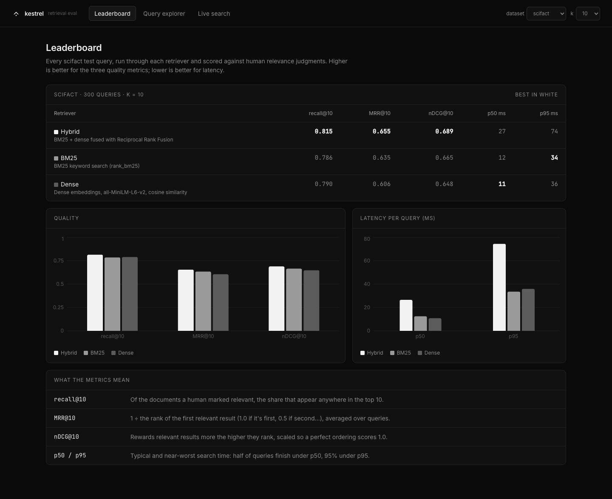
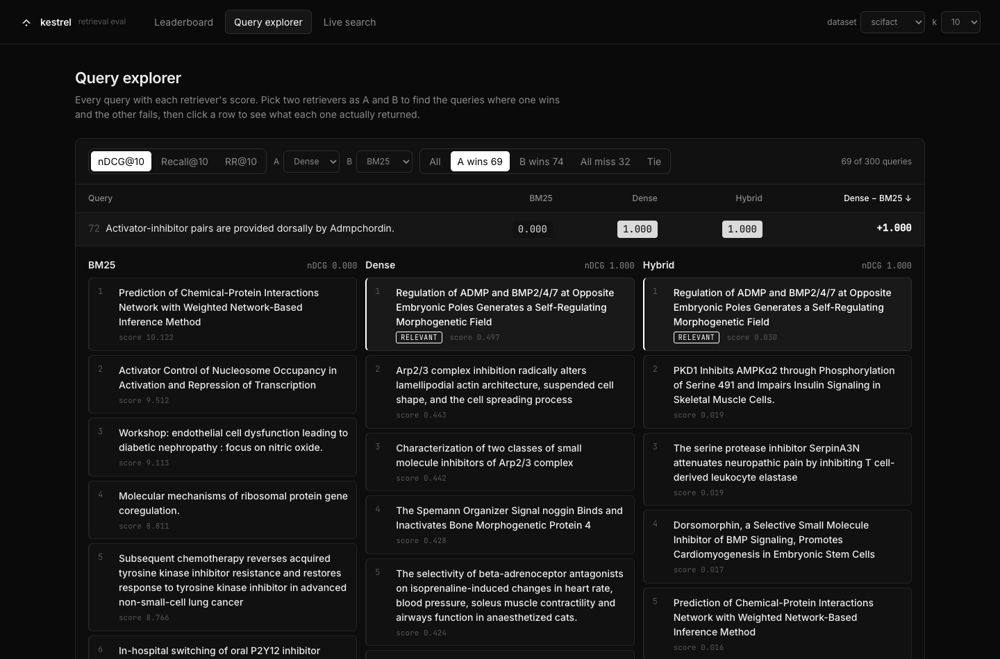
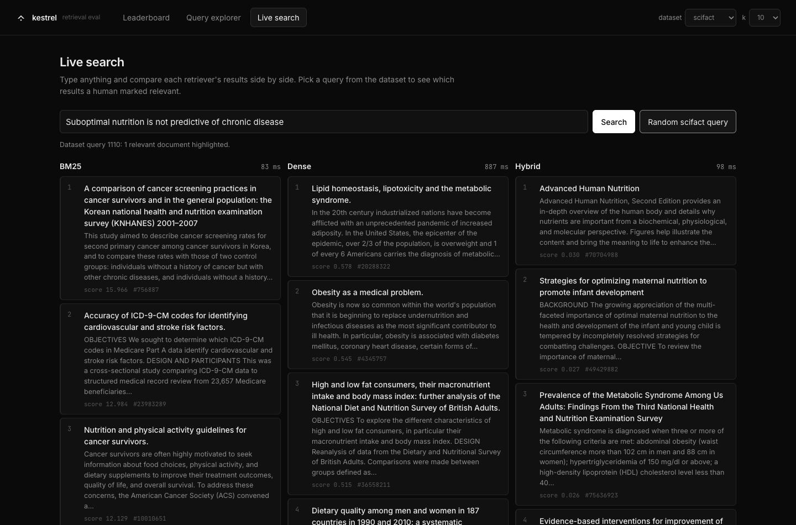

# kestrel

[](https://github.com/roridemonslayer/kestrel/actions/workflows/ci.yml)



A test bench for search quality. Pick a dataset, run its queries through several retrievers (BM25, dense embeddings, hybrid), and compare them with standard IR metrics (recall@k, MRR, nDCG@k) and latency.

It's also the start of a shared retrieval layer: the code in `backend/retrieval/` is plain Python with no web code, so later projects can reuse it.

## Status

- [x] BEIR dataset loader (SciFact, NFCorpus, ArguAna, FiQA)
- [x] Retriever interface + BM25 (index cached to disk)
- [x] Metrics (recall@k, MRR, nDCG@k in plain Python) + hand-checkable tests
- [x] Eval runner + CLI
- [x] Dense retriever (all-MiniLM-L6-v2, embeddings cached to disk)
- [x] Hybrid (Reciprocal Rank Fusion)
- [x] API (FastAPI)
- [x] Web UI: leaderboard, query explorer, live search

## Results (SciFact, 300 test queries, k = 10)

| Retriever | recall@10 | MRR@10 | nDCG@10 | p50 ms | p95 ms |
|---|---|---|---|---|---|
| Hybrid + cross-encoder rerank | **0.822** | **0.657** | **0.691** | 1467 | 3205 |
| Hybrid (BM25 + dense, RRF) | 0.815 | 0.655 | 0.689 | 39.8 | 119.0 |
| BM25 | 0.786 | 0.635 | 0.665 | 17.4 | 42.0 |
| Dense (all-MiniLM-L6-v2) | 0.790 | 0.606 | 0.648 | 12.8 | 65.9 |
| HNSW, built from scratch ([vector-search-engine](https://github.com/roridemonslayer/vector-search-engine)) | 0.773 | 0.596 | 0.637 | 43.0 | 148.2 |

BM25's nDCG@10 of 0.665 matches the BM25 baseline in the BEIR paper, and MiniLM's 0.648 matches its published SciFact score, which is a good check that the loader and metrics are right. Hybrid wins on every quality metric because keyword and semantic search fail on different queries. Latency is measured on a MacBook Air (M2); hybrid pays for running both retrievers.

My own [from-scratch HNSW engine](https://github.com/roridemonslayer/vector-search-engine) (pure Python, no numpy or FAISS) searches the same MiniLM embeddings approximately and keeps 98% of exact dense search's nDCG@10 (0.637 vs 0.648). It's slower here only because it's pure Python against numpy's vectorized math; it's plugged in to show a hand-built index holding up on real data. It appears when `vector-search-engine` is checked out next to `kestrel` (or set `KESTREL_HNSW_PATH`).

Reranking hybrid's top 50 with a cross-encoder (`ms-marco-MiniLM-L-6-v2`) barely helps here (+0.002 nDCG@10) while making each search about 45× slower. That model was trained on web search questions, not scientific claims, so on SciFact it mostly agrees with hybrid's order; a domain-matched reranker is the next thing to try.

### NFCorpus (323 test queries, k = 10)

| Retriever | recall@10 | MRR@10 | nDCG@10 | p50 ms | p95 ms |
|---|---|---|---|---|---|
| Hybrid (BM25 + dense, RRF) | **0.167** | **0.547** | **0.344** | 19.5 | 139.9 |
| Dense (all-MiniLM-L6-v2) | 0.159 | 0.506 | 0.318 | 9.3 | 47.2 |
| BM25 | 0.152 | 0.515 | 0.308 | 3.3 | 15.9 |

NFCorpus queries have dozens of relevant documents each, so recall@10 is low for every retriever by design; nDCG uses its graded (1 or 2) judgments.

### ArguAna (1,406 test queries, k = 10)

| Retriever | recall@10 | MRR@10 | nDCG@10 | p50 ms | p95 ms |
|---|---|---|---|---|---|
| Hybrid (BM25 + dense, RRF) | **0.812** | **0.435** | **0.524** | 326.0 | 639.7 |
| Dense (all-MiniLM-L6-v2) | 0.771 | 0.394 | 0.483 | 17.2 | 30.4 |
| BM25 | 0.747 | 0.392 | 0.477 | 307.6 | 632.0 |
| HNSW, built from scratch | 0.763 | 0.389 | 0.477 | 38.8 | 48.7 |
| Hybrid + cross-encoder rerank | 0.706 | 0.343 | 0.428 | 955.3 | 1201.2 |

Each ArguAna query is a debate argument, and the one relevant document is its best counter-argument. The queries are long (174 words at the median), which is why BM25 is slow here: it scores every word of the query against every document.

- **A query is its own top hit.** 1,298 of the queries are documents in the corpus, so every retriever ranks the query first. BEIR's evaluation drops a query's own document from its results, and so does kestrel for datasets in `DROP_SELF_MATCHES` (eval and live search). Like BEIR, it matches by id, so the 108 queries whose text appears in the corpus under a different id still find that copy, which only pushes the real answer down.
- **Dense matches its published score.** MiniLM's 0.483 is close to its MTEB ArguAna score (0.502). BM25 scores higher than the BEIR paper's (0.315; 0.414 in later Pyserini runs) because it uses different settings: k1 = 1.5, b = 0.75, no stemming, and rank_bm25's IDF.
- **The reranker hurts.** It costs 0.096 nDCG@10. `ms-marco-MiniLM-L-6-v2` learned to find passages that answer a question, so it likely favors arguments on the same side as the query over the counter-argument (and it truncates these long query + document pairs at 512 tokens). The BEIR paper saw the same thing with its MS MARCO cross-encoder on ArguAna. Whether a reranker helps depends on the task it was trained for.

### FiQA (648 test queries, k = 10)

| Retriever | recall@10 | MRR@10 | nDCG@10 | p50 ms | p95 ms |
|---|---|---|---|---|---|
| Hybrid + cross-encoder rerank | **0.451** | **0.448** | **0.376** | 769.1 | 1218.2 |
| Dense (all-MiniLM-L6-v2) | 0.439 | 0.446 | 0.369 | 16.8 | 37.3 |
| Hybrid (BM25 + dense, RRF) | 0.419 | 0.413 | 0.342 | 152.4 | 312.0 |
| BM25 | 0.295 | 0.283 | 0.231 | 123.6 | 228.1 |

FiQA asks personal finance questions ("Where should I park my rainy-day / emergency fund?") and answers them with posts from finance forums. The 57,638 posts have no titles, and the median query has 2 relevant answers.

- **Both baselines match published scores.** BM25's 0.231 is close to the BEIR paper's 0.236, and MiniLM's 0.369 matches its MTEB FiQA score.
- **Hybrid loses to dense.** This is the only dataset here where fusing BM25 in hurts (-0.027 nDCG@10). People ask about money in different words than the answers use ("park my emergency fund" vs. "high-yield savings account"), so BM25 trails dense by 0.138, and RRF weighs both lists equally, letting BM25's misses push down dense's good results. Fusion pays off when both retrievers are about as good but fail on different queries, as on SciFact.
- **The reranker helps here.** It adds 0.034 over hybrid and edges out dense. FiQA's questions look like the web search questions `ms-marco-MiniLM-L-6-v2` was trained on, unlike ArguAna's counter-arguments, where the same reranker cost 0.096.

## The app

- **Leaderboard**: recall@10, MRR@10, nDCG@10, p50/p95 latency per retriever, with charts.
- **Query explorer**: every query's score per retriever. Pick two retrievers to find where one wins and the other fails, then open a query to see each one's actual top results, with relevant documents marked and any that every retriever missed.
- **Live search**: type a query and see the retrievers side by side; dataset queries highlight the documents a human judged relevant.





## How it fits together

```
backend/
  retrieval/   Retriever interface (index, search) + BM25, dense, hybrid. No web code, reusable elsewhere.
  data/        BEIR loader: corpus, queries, qrels
  eval/        metrics (plain Python), runner, CLI
  api/         FastAPI app
frontend/      React + Vite + Recharts
```

`retrieval/rerank.py` wraps any retriever with a cross-encoder second stage (retrieve, then rerank). Evaluations are saved under `.cache/evals/`, so restarts don't re-run them.

Adding a retriever means implementing `index(docs)` and `search(query, k)` from `retrieval/base.py` and registering it in `retrieval/registry.py`. Indexes and embeddings are cached under `.cache/`, keyed by a fingerprint of the corpus.

## Setup

```bash
uv venv --python 3.12 .venv
uv pip install --python .venv/bin/python -r backend/requirements.txt
cd backend
../.venv/bin/python -m data.loaders scifact   # downloads SciFact once, prints its size
../.venv/bin/python -m pytest
../.venv/bin/ruff check . && ../.venv/bin/ruff format --check .   # lint + formatting
../.venv/bin/python -m eval.cli --dataset scifact --k 10   # prints the results table (add --format markdown or json)
```

Run the app (two terminals):

```bash
cd backend && ../.venv/bin/uvicorn api.main:app --port 8077   # API; warms indexes on startup
cd frontend && npm install && npm run dev                      # UI at http://localhost:5173
```
